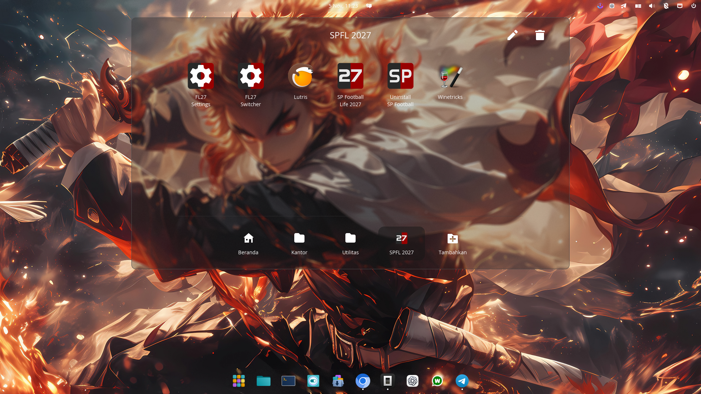
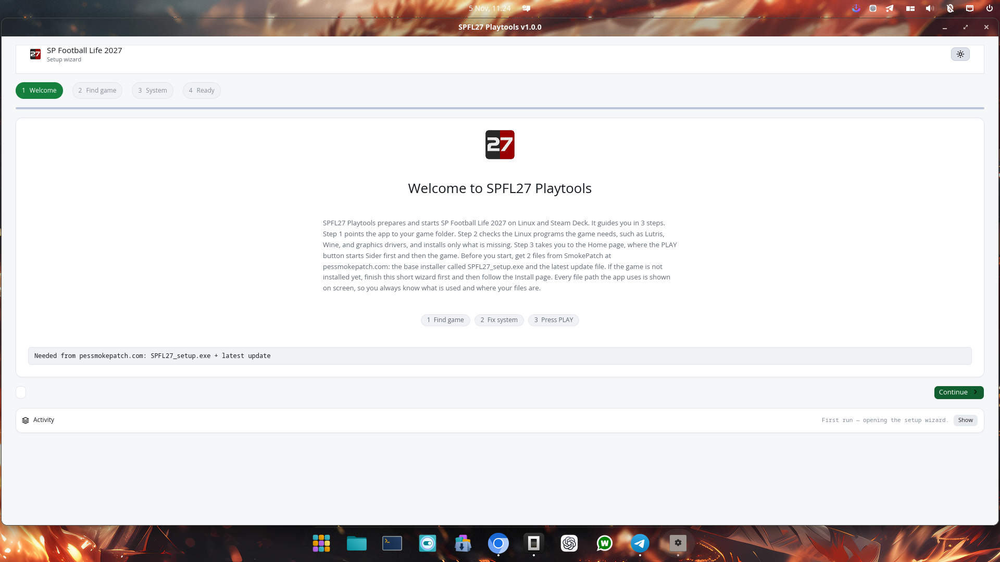
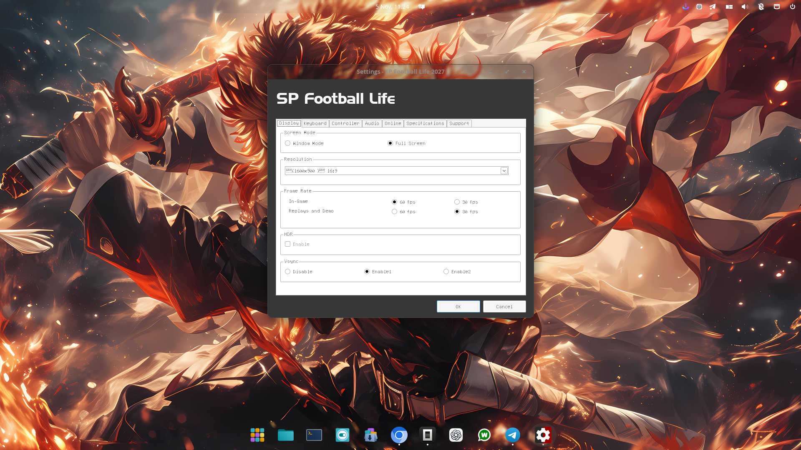
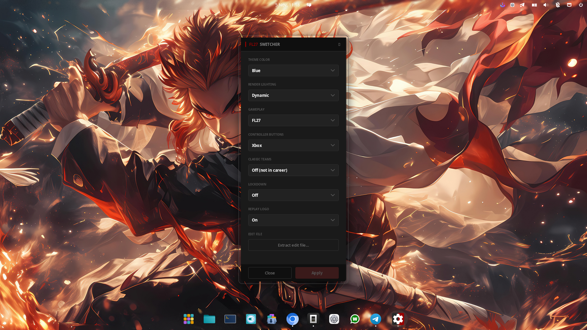
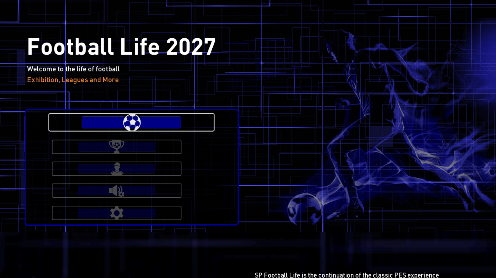

# SP Football Life 2027 for Linux

Installer and Playtools package for **SP Football Life 2027** (SmokePatch) on Linux and
Steam Deck. It ships a native Rust launcher (iced), a Lutris installer script, one
Sider Lua module, and CPK content packs (classic teams, controllers, gameplay).

This project is **safe to use and fully auditable**: all scripts are plain text, all
Rust code is open and compiles from source, and every step is verifiable. If anything
is unclear, ask an AI agent (e.g. OpenCode) — it can read this repository and run
the checks for you.

## Screenshots

SPFL 2027 menu group (all main tools in one place):



Playtools app (setup wizard):



FL27 Settings (1600x900, 60 fps, VSync Enable1):



FL27 Switcher (theme, lighting, gameplay, controller buttons):



The game actually running on Linux (Football Life 2027 main menu):



## What you need (prerequisites)

| Component | Minimum | Needed for | Check command |
|-----------|---------|------------|---------------|
| Lutris | 0.5.20 | game install | `lutris --version` |
| Wine | 10.0 | game install and tools | `wine --version` |
| Winetricks | any | game install | `winetricks --version` |
| Rust | 1.88 | optional Playtools app only | `rustc --version` |
| Vulkan drivers | any | optional graphics check | `vulkaninfo --summary` (optional) |

Arch/CachyOS one-liner:

```bash
sudo pacman -S rust lutris wine winetricks vulkan-tools
```

## Pre-install checklist

Before installing, verify:

1. `lutris --version` prints 0.5.20 or newer.
2. `wine --version` prints 10.0 or newer.
3. `winetricks --version` works.
4. You have the two SmokePatch files: `SPFL27_setup.exe` and the latest update.
5. At least 80 GB of free space on the target disk (game ~23 GB + facepacks ~42 GB).
6. The target disk is mounted and writable.
7. `rustc --version` prints 1.88 or newer only if you also want the optional
   Playtools app.

Rust is optional. The game itself is installed and repaired with plain shell
scripts and Lutris.

## Choose your setup

**Game install only (no Rust needed)**

Use this if you only want to install and play the game:

```bash
lutris -i lutris/sp-football-life-2027.yaml
./lutris/spfl2027-fix.sh check
```

Launch from the COSMIC/Lutris menu entry `SP Football Life 2027`, or run
`~/.local/bin/spfl2027` if you created that launcher. The Windows tools have
their own menu entries: `FL27 Settings` and `FL27 Switcher`.

**Optional Playtools app (needs Rust)**

Use this if you want the native setup wizard, dependency checks, game
launcher, save backups, and the simplified Settings/Switcher pages:

```bash
cd native && cargo build --release
./native/run.sh
```

Both setups use the same Lutris installer and repair scripts. The Playtools
app is a helper around them, not a replacement for the install.

## Layout

- `native/` — Rust app `spfl27` (`src/`, `tests/e2e.rs`, `assets/`, `run.sh`)
- `lutris/` — `sp-football-life-2027.yaml` installer + `spfl2027-fix.sh` + `spfl2027-var.sh` + `spfl2027-stop.sh`
- `sider/modules/` — `aspectratio.lua`
- `mods/offside-var/` — bundled Offside VAR mod (Sider + ReShade banner)
- `data/cpk/` — `Classics/`, `Controller/{ps3,ps4,ps5,xbox}/`, `GP/`
  (empty placeholders — real CPKs are downloaded separately and not committed)

## Build and test (Playtools app, optional)

```bash
cd native && cargo build --release     # build the spfl27 app
./native/run.sh                        # build if stale, then run
cd native && cargo test                 # run the e2e suite
cd native && cargo clippy --all-targets # lint (pre-existing style warnings)
```

## Install the game (shell/Lutris path)

This is the path that does not need Rust. It creates the Wine prefix,
installs the Windows dependencies, runs the SmokePatch installer, and writes
`FL_2027.bat`.

```bash
lutris -i lutris/sp-football-life-2027.yaml
```

The installer does, in order:

1. Create the Wine prefix.
2. Install .NET Framework 4.8.
3. Install .NET Framework 8.0.
4. Install `vcrun2022`, `unifont`, `win10`.
5. Run the game installer (you point Lutris at `SPFL27_setup.exe`).
6. Rename `xinput1_3.dll` to `ddraw.dll` (backup kept as `xinput1_3.dll.bak`).
7. Map `Segoe UI` / `Segoe UI Semibold` fonts to a system font (for the WPF Switcher).
8. Run the gameplay Switcher once.
9. Apply the aspect-ratio fix (`aspectratio.lua`).
10. Write `FL_2027.bat`.

## How to use

With the Playtools app, use its Home page and press **PLAY**. Without it,
use the menu entries below; both clean up leftover game processes after the
window closes.

- **Play:** menu entry `SP Football Life 2027` (or `~/.local/bin/spfl2027`).
  Sider starts first, then the game. Only the game window opens.
- **Settings:** menu entry `FL27 Settings` — display, controller, audio, etc.
  Set VSync to `Enable1` to cap 60 fps and reduce heat.
- **Switcher:** menu entry `FL27 Switcher` — gameplay, controller buttons, classic
  teams, lockdown, replay logo.
- **Stop a stuck game:** the desktop launcher cleans up automatically a few
  seconds after the game window is gone. If anything remains, run
  `spfl2027-stop` (or Ctrl+C in the launcher terminal).
- **Health check:** `./lutris/spfl2027-fix.sh check` (exit 0 = healthy).
- **VAR check:** `./lutris/spfl2027-var.sh check` (exit 0 = VAR installed).
  Install with `./lutris/spfl2027-var.sh install` (uses `mods/offside-var/`).
- **Test notes:** `TEST_NOTES.md` (OS, device, settings, FPS, temperature).

## Offside VAR (optional)

The VAR-style offside wall, camera, and banner are bundled in
`mods/offside-var/` (see `mods/offside-var/README.md`). It needs Sider 7
with LuaJIT plus `nesalib.lua` / `CommonLib.lua` (already in the game), and
ReShade 6.x with full add-on support for the banner only.

```bash
./lutris/spfl2027-var.sh check
./lutris/spfl2027-var.sh install
# or: ./lutris/spfl2027-var.sh install --zip /path/to/FL27_Pes21_Offside_VAR_1.0-rc.zip
```

Then launch the game as usual. In the ReShade overlay (default Insert key),
the `OffsideBanner` effect and the `offside_banner` add-on should both be
visible. Remove the mod with `./lutris/spfl2027-var.sh remove`.

## Tool repair (Settings / Switcher)

If Settings or Switcher fail to open:

```bash
./lutris/spfl2027-fix.sh check    # check only, change nothing
./lutris/spfl2027-fix.sh         # check and repair what is missing
```

Checks: tool files present, Windows 10 prefix, .NET 4.8 (registry `Release` >= 528040),
`Segoe UI` font mapping, `ddraw.dll`, DXVK. Idempotent and safe to run repeatedly.

Locate a non-standard prefix with `SPFL2027_PREFIX=/path/to/prefix`.

## Safety and verification

- All scripts are plain bash; read them before running.
- All Rust code compiles from source; run `cargo test` to verify (31 + 19 + 5 tests).
- The installer YAML is plain text; inspect `lutris/sp-football-life-2027.yaml`.
- No binary blobs are executed except the game's own installers from SmokePatch.
- Backups are kept: `xinput1_3.dll.bak`, `download-backup/`.
- If something breaks, restore from the backups or re-run `spfl2027-fix.sh`.

## License

Free for the **community, non-commercial only** — you may use, copy, modify, and
share this project freely, but you may **not sell it** or use it commercially.
License: **CC BY-NC 4.0** (see `LICENSE`).

Not covered: the game, SmokePatch installers/CPKs and all game content belong to
SmokePatch (pessmokepatch.com) — get them from the official site and follow
their terms. Third-party icons in `native/assets/icons/` keep their own license
(`native/assets/ICONS-LICENSE.txt`, Lucide/ISC).

## If you are confused

Ask an AI agent (OpenCode, Claude, etc.). It can read this repository, run
`cargo test`, run `./lutris/spfl2027-fix.sh check`, and explain any step. Point it
at `README.md`, `INSTALL.md`, and `AGENTS.md`.

## Agent entry points

- Health: `./lutris/spfl2027-fix.sh check` (exit 0 = healthy).
- Repair: `./lutris/spfl2027-fix.sh`.
- Stop: `spfl2027-stop`.
- Installer: `lutris/sp-football-life-2027.yaml`.
- Details: `INSTALL.md`, `AGENTS.md`.